Developer Community Platform
    A full-stack developer community platform built with Next.js 16, MongoDB Atlas, NextAuth and Tailwind CSS.
    This platform allows developers to create profiles, publish blogs,join communities, and connect with other developers through a modern and responsive web application. 
Features:
  Authentication
   -Google OAuth login.
   -Github OAuth login,
   -Persistent user sessions.
   -Protected routes and API endpoints.
 Developer Profiles
   -public dev profiles.
   -Edit profile
   -bio/headline/github and linkedIn URLs.
   -see joined communities and published posts.
 Blogs
   -Create,Edit,delete,view blogs.
   -Blog ownership protection.
   -Reading time estimation,metadata generation.
   -ISR 
 Communities
   -Browse communities.
   -join,leave community.
   -related blogs.
 Experience:
   -Responsive design for all screen sizes(mobile,desktop,tablet).
   -loading,error and not-found pages.
   -Consistent UI and user-friendly design.

Tech Stack:
 Backend
   -Next.js
   -NextAuth.js
 Frontend
   -Next.js 16 App Router.
   -React
   -Typescript
   -Tailwind CSS.
 Database
   -MongoDB Atlas.
   -Mongoose
 Authentication
   -Google/Github OAuth.
 Deployment
   -Vercel.

Local Installation:
-clone repository
 git clone https://github.com/jackysaliba1/dev-Community-platform.git

-Create the environment file: .env.local
Add: MONGODB_URI=

AUTH_SECRET=

AUTH_GOOGLE_ID=
AUTH_GOOGLE_SECRET=

AUTH_GITHUB_ID=
AUTH_GITHUB_SECRET=   ...
4-Run development server:npm run dev

MongoDB Atlas Setup
  Create a cluster:
   -create a mongodb account.
   -create a new cluster.
   -create a db user.
   -Add IP address.
   -Copy connection string and paste it into .env.local
Google OAuth Configuration
 Create credentials:
  -open cloud console.
  -create a project
  -create OAuth client credentials.
  links: http://localhost:3000
  -http://localhost:3000/api/auth/callback/google

Github OAuth Configuration
  -open github developer settings.
  -create new OAuth app
  links: http://localhost:3000
  callbackURL: http://localhost:3000/api/callback/github
  then copy the client id and secret into .env.local.

Rendering Strategy:
  The application uses a combination of Next.js rendering strategy.
  Server components:
  used for:-blogs,communities,profile and home pages.
   This reduces client-side javascript and improves the performance.
  Client Components:
  Used only where interactivity is required:
    -Authentication buttons
    -Community join/leave actions
    -Profile,Blog forms
    -Navigation menu
  ISR:
  Blog listing uses Increment static regeneration:export const revalidate=60;

  Database models:
   User Model:stores information about developers.
       name
       username
       email
       image
       headline
       bio
       skills
       githubURL
       linkedInURL
       providerIds 
  Blog Model:Stores published blogs and posts.
       title
       slug
       excerpt
       content
       coverImage
       tags
       author
       status
       publishedAt -So a blog belongs to one User-

  Community Model:Stores the communities.
       name
       slug
       description
       category
       members
-so a community can have many members-(one-to-many relationship).

Security and Authorization:
  The application protects sensitive actions using session-based authentication.

Authenticated users can:

Create blogs
Edit their own blogs
Delete their own blogs
Edit their profile
Join / Leave communities

Ownership checks prevent users from modifying content that does not belong to them(very important)!

Deployment:
 link:
 github repos:

 Testing:
the project was tested using: 
  -thunder client.
  -Responsive broser testing.
  verification:
  -authentication.
  -CRUD.
  -Community membership
  -loading and error states.
  -mobile responsiveness.

 Future improvements:
  -Comments on blogs.
  -Notifications for users.
  -Profile avatars upload.
  -Moderators.

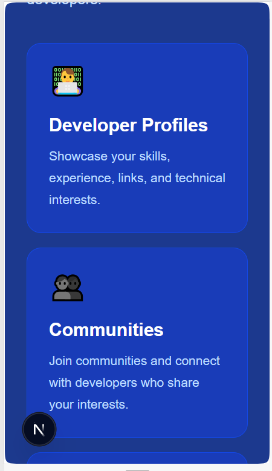
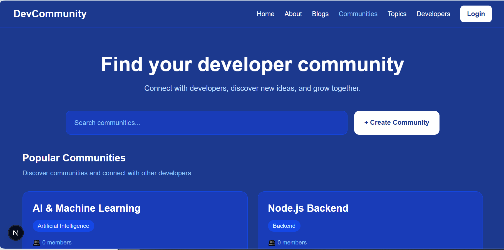
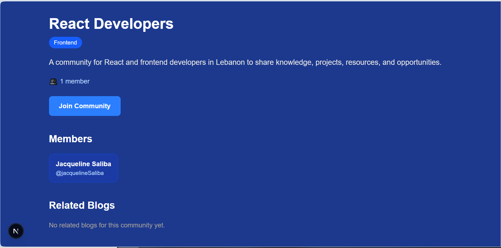
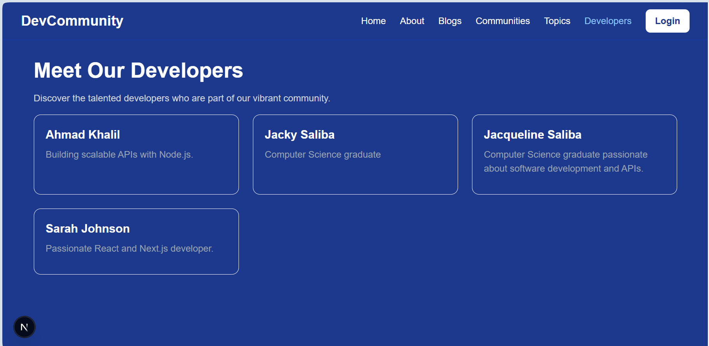
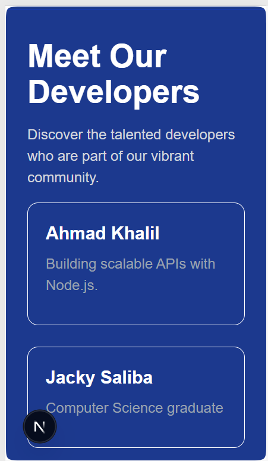
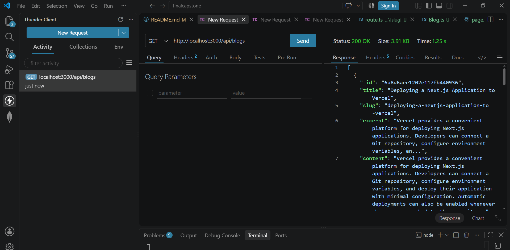
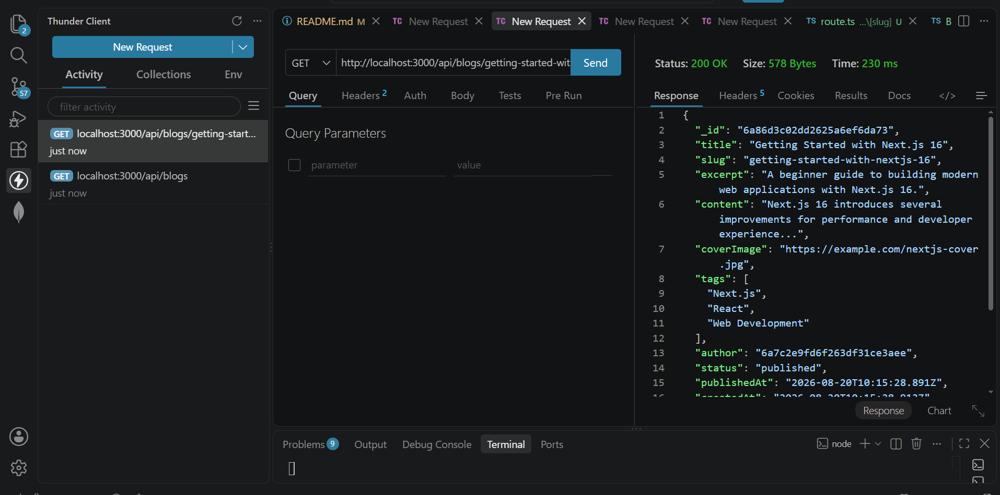

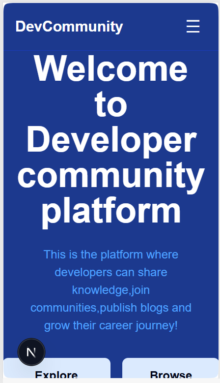
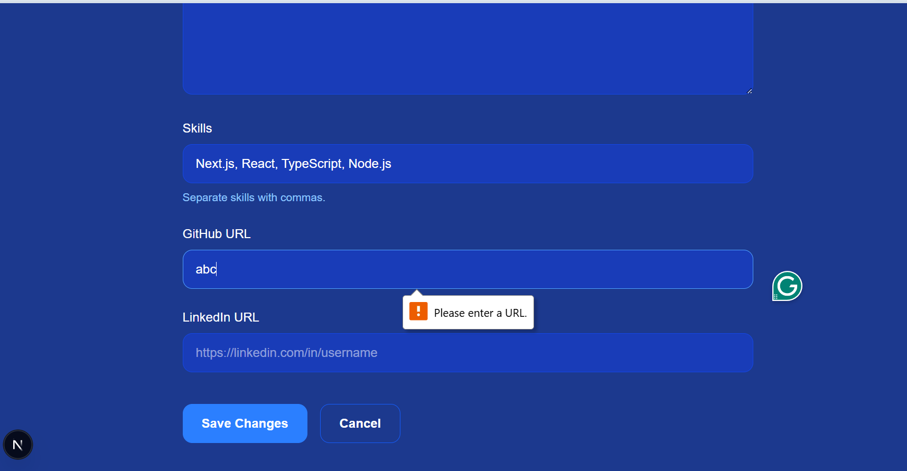
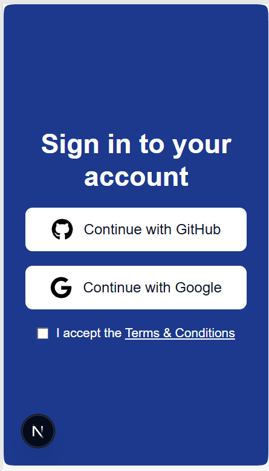

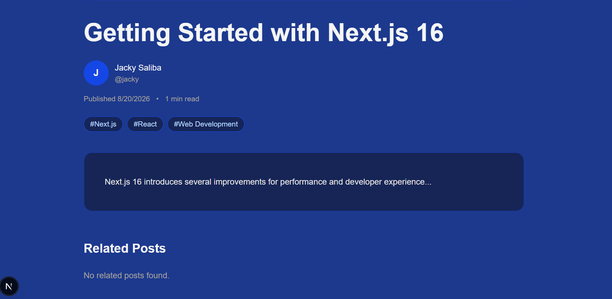
